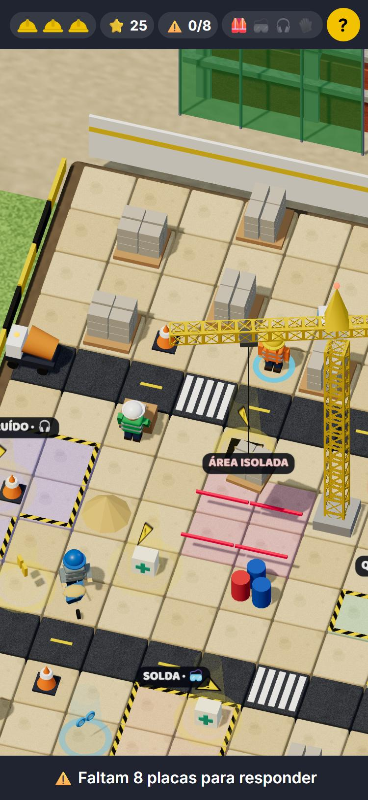
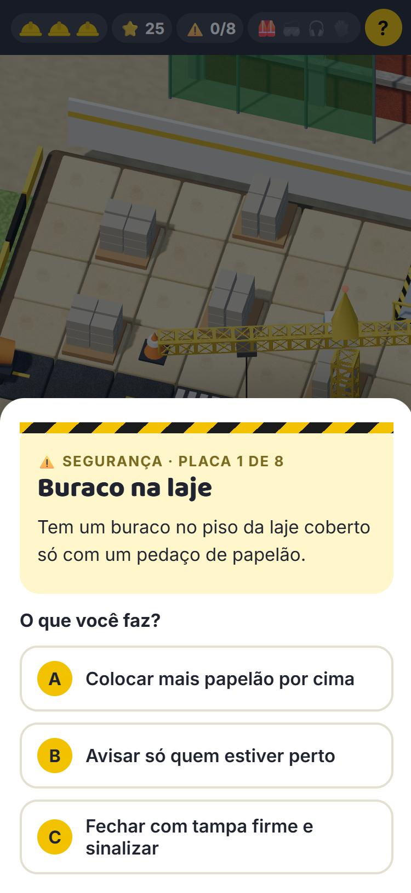

# 👷 Canteiro Seguro

Jogo de celular sobre **segurança do trabalho e saúde no canteiro de obras**, feito para ações de **SIPAT**.
Partidas de 3 a 5 minutos, linguagem simples e controles de um toque — pensado para equipes com níveis
muito diferentes de familiaridade com tecnologia.

**▶ Jogar a demonstração:** https://vmassini.github.io/canteiro-seguro/

<p align="center">
  
  &nbsp;
  
</p>

## Como funciona

A pessoa informa nome completo e obra e entra num canteiro em 3D. É só **tocar no chão** para andar.

1. **Pegue os EPIs** — cinto, protetor auricular, óculos e luvas. Cada área de risco (altura, ruído,
   solda, produtos químicos) só libera a entrada com o EPI certo, e o jogo explica para que ele serve.
2. **Responda as placas ⚠️** — 8 situações sorteadas de 34 (segurança no canteiro e saúde), com
   3 alternativas. Depois de cada resposta aparece a atitude certa e o porquê. Errar uma situação grave
   custa um dos 3 capacetes.
3. **Chegue ao ponto de encontro** — atravessando a rua só pela faixa e longe da carga suspensa.

No fim: pontuação, posição no ranking e a tela **"O que aprendi"** com o resumo das respostas.
Pode jogar quantas vezes quiser; no ranking vale a **melhor partida** de cada pessoa.

Temas: eletricidade, altura e andaimes, escavações, carga suspensa, máquinas, organização, sinalização,
extintor e rota de fuga, quase-acidente, DDS — e saúde: calor e hidratação, sol, coluna, álcool, sono,
remédios, alimentação, cortes e vacina, poeira, audição, saúde mental (CVV 188) e primeiros socorros (SAMU 192).

## Como usar numa SIPAT

- **Abertura:** apresente o jogo no DDS e divulgue o link/QR code nas obras.
- **Durante a semana:** o ranking (`ranking.php`) atualiza sozinho — deixe numa TV no refeitório. Dá para filtrar por obra.
- **Quem não tem celular:** um tablet fixo com alguém da CIPA ajudando.
- **Painel do organizador** (`admin.php`): mostra em quais situações o pessoal mais erra (ótimo para escolher temas
  de palestra e DDS), participação por obra, ranking com nome completo e exportação em CSV para a premiação.
- **Encerramento:** premie os melhores (geral e por obra) e comente as situações com mais erros.

## Duas formas de rodar

| | Demonstração | Versão completa |
|---|---|---|
| Onde | Qualquer hospedagem estática (GitHub Pages, Netlify, Cloudflare Pages…) | Servidor com **PHP 7.4+** e **MySQL/MariaDB** |
| Ranking | Só no aparelho (navegador) | Compartilhado entre todos |
| Painel admin | — | ✅ com senha |
| Custo | Grátis | Qualquer hospedagem PHP comum |

A demonstração é publicada automaticamente pelo GitHub Actions (`.github/workflows/demo-pages.yml`) a cada push
no `main`, usando `ferramentas/gerar-demo.sh`, que transforma as páginas em HTML estático e liga o modo demo
(`assets/demo.js` guarda partidas e ranking no `localStorage`).

## Instalar a versão completa

1. Copie a pasta para o servidor (ex.: `https://seu-site/sipat/`). Não precisa de build nem de Composer.
2. Crie um banco MySQL/MariaDB vazio e um usuário com acesso a ele.
3. Copie `includes/segredos.exemplo.php` para `includes/segredos.php` e preencha banco e senha do painel.
   O hash da senha é gerado com:
   ```bash
   php -r "echo password_hash('SUA_SENHA_FORTE', PASSWORD_DEFAULT), PHP_EOL;"
   ```
4. Abra o jogo. As tabelas (`sipat_partida`, `sipat_obra`) são criadas sozinhas no primeiro acesso.
5. Entre em `admin.php`, cadastre as obras e, antes de abrir ao público, use **Zerar tudo** para apagar partidas de teste.

`includes/.htaccess` bloqueia o acesso direto aos arquivos de configuração (Apache). Em Nginx, negue `/includes/`.

## Personalizar

- **Placas e textos:** `assets/conteudo.json` — título, situação, 3 alternativas, índice da certa (`certa`),
  se é grave (`grave`) e a explicação (`porque`). O jogo embaralha a ordem das alternativas.
  Dica: cuidado para a resposta certa não ser sempre a mais longa.
- **Mapa:** no mesmo arquivo, `mapa.grade` (a legenda está no próprio JSON), posições dos EPIs e das placas.
- **Obras:** no painel. A lista do primeiro uso pode vir de `OBRAS_INICIAIS` no `segredos.php`.
- **Zoom da câmera:** constante `ZOOM` em `assets/game.js`.

## Estrutura

```
index.php            tela do jogo
ranking.php          ranking público (bom para TV)
admin.php            painel do organizador (senha)
api.php              obras, salvar partida e ranking (recalcula os pontos no servidor)
includes/config.php  banco, regras de pontuação e ranking
assets/game.js       o jogo (Three.js, tudo no navegador)
assets/conteudo.json placas, EPIs e mapa
assets/demo.js       modo demonstração sem servidor
ferramentas/         gerador do site estático da demo
```

Feito com [Three.js](https://threejs.org/) (carregado de CDN) e PHP puro, sem dependências para instalar.
O 3D é todo construído com formas simples e texturas geradas no próprio navegador — não há imagens para baixar.

## Aviso

O conteúdo é educativo e de linguagem propositalmente simples. Ele **não substitui** treinamentos obrigatórios
nem as Normas Regulamentadoras. Revise as placas com o SESMT/técnico de segurança da sua empresa antes de usar.

## Licença

[MIT](LICENSE) — pode usar, adaptar e redistribuir, inclusive na sua empresa.
Contribuições (novas placas, mapas, correções) são bem-vindas via issues e pull requests.
